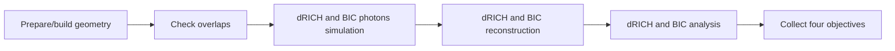

# AID2E dRICH and BIC Example

Run test dRICH and BIC optimization with AID2E. This example optimizes six dRICH geometry parameters and five BIC stave switches together. Each trial uses one geometry and returns four objectives: maximize low/high-eta pi/K separation and acceptance, and minimize BIC photon phi resolution. 
## Files

- `workflow.yml`: example config optimizer, scheduler, and ePIC workflow
- `design.params`: geometry parameters and XML edit targets for both detectors
- `combined_utils.py`: job payloads and objective collection for both detectors
- `scripts/`: dRICH bootstrap analysis, Makefile, and BIC analysis

## Workflow



The shared simulation stage uses separate dRICH and BIC job factories to run up to 11 jobs concurrently. Reconstruction and analysis also use separate detector templates: 8 dRICH reconstruction jobs and 1 BIC merge+reconstruction job, followed by 4 dRICH analysis jobs and 1 BIC analysis job using the original scripts. Jobs within each stage run concurrently. All simulation jobs finish before reconstruction starts; each particle and scan point keeps its own file. Both detectors use the same trial geometry, and all four objectives are returned to the optimizer together.

Simulation arguments set the number of events per dRICH particle/scan point and BIC photon energy. `evaluation_config.bic_energies` sets the three photon energies to 1, 2, and 5 GeV. 

Each trial submits 26 Slurm jobs before retries: 1 geometry, 8 dRICH simulation, 8 dRICH reconstruction, 4 dRICH analysis, 3 BIC simulation, 1 BIC reconstruction, and 1 BIC analysis. The number of trial workflows that can run at once is set in global scheduler.

## ePIC Setup

Set the ePIC source checkout and eic-shell paths under `epic_environment` in `workflow.yml`. `geometry_mode: build` copies, modifies, and builds the geometry for each trial. Both detectors use that trial's installed geometry. The source checkout must contain both XML files in `design.params` and enable both detectors in the selected configuration.

The dRICH analysis script will need to be built from within eic-shell before running the optimization:

```bash
make -C examples/epic/drich_bic/scripts
```

## Run

To run via Slurm, edit the account and partition in `workflow.yml` as needed. With AID2E installed and Slurm available, run from the framework checkout:

```bash
aid2e optimize examples/epic/drich_bic/workflow.yml --validate-only
aid2e optimize examples/epic/drich_bic/workflow.yml --run-id drich_bic_test -v
```

Outputs and working files go under `examples/epic/drich_bic/output/<run-id>` and `examples/epic/drich_bic/work/<run-id>`. Geometry overlaps receive configured penalties; other execution or analysis failures are marked failed. 